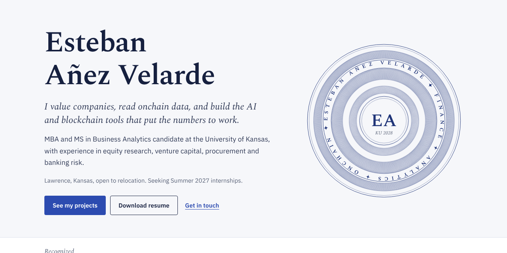
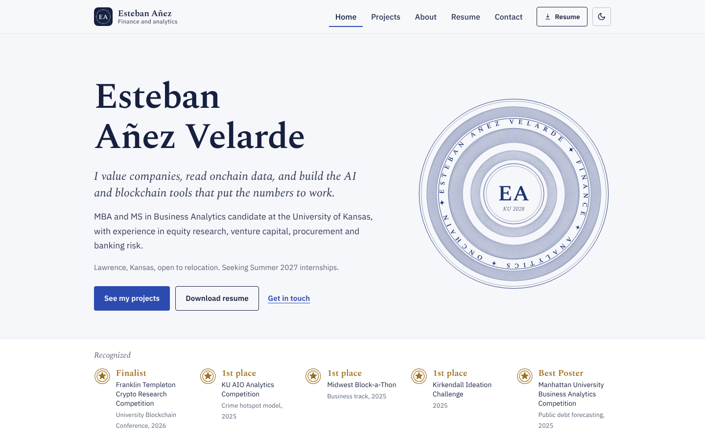

<p align="center"></p>

# Esteban Añez Velarde · Portfolio

My personal portfolio site: finance, business analytics and AI projects, plus experience and resume.

**Live site:** https://estebananez.github.io/Esteban-Anez---Portfolio-Website/



## What's inside

| Page | Content |
|---|---|
| Home | Short intro and featured projects |
| Projects | Filterable case studies: problem, approach, tools and results for each project |
| Resume | Web version of my resume plus a PDF download |
| About | Background, education and languages |
| Contact | Email, LinkedIn and GitHub |

Featured work includes [Snippet](https://github.com/adityak8989/UBC_2026_Snippet) (onchain clip licensing, UBC 2026 hackathon), [EquityIQ](https://github.com/EstebanAnez/EquityIQ) (AI equity research agent), [Scout](https://github.com/EstebanAnez/Scout) (AI business analyst), equity research and valuation reports, and a Best Poster public debt forecasting model.

## How it's built

- Plain HTML, CSS and JavaScript with no framework and no build step
- All project and experience content lives in two data files (`assets/js/projects.js` and `assets/js/experience.js`), and the pages render from them, so adding a project means editing one object
- Fully static: fonts, icons and images are local, and it works offline straight from the file system
- Accessible and SEO ready: semantic HTML, alt text, Open Graph tags and JSON-LD structured data
- Deployed to GitHub Pages automatically on every push with GitHub Actions (`.github/workflows/static.yml`)

## Run locally

```bash
git clone https://github.com/EstebanAnez/Esteban-Anez---Portfolio-Website.git
cd Esteban-Anez---Portfolio-Website
# open index.html in any browser
```

Maintenance notes (updating projects, resume, images) are in [`docs/MAINTAINING.md`](docs/MAINTAINING.md).

---

[LinkedIn](https://www.linkedin.com/in/esteban-anez) · [GitHub](https://github.com/EstebanAnez)
